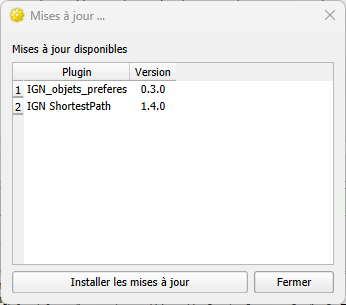
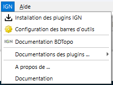
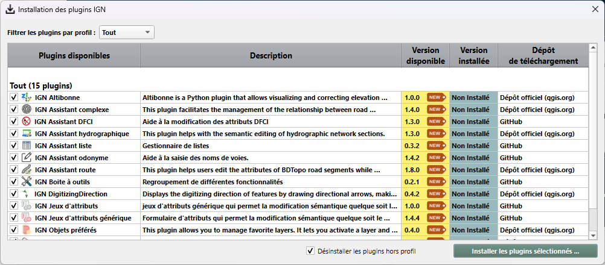
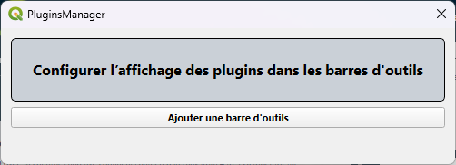
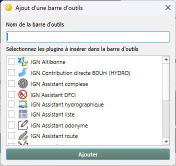
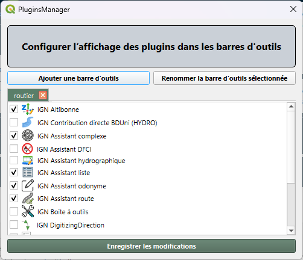

<table>
<colgroup>
<col style="width: 21%" />
<col style="width: 78%" />
</colgroup>
<tbody>
<tr>
<td rowspan="2"></td>
<td style="text-align: center;font-size: 24px;"><strong>PluginsManager</strong></td>
</tr>
<tr>
<td style="font-size: 16px;text-align: center;">Développeur  : Gérôme PECHEUR (IGN)</td>
</tr>
</tbody>
</table>
  

## Sommaire

- [1. Prérequis](#prerequis)
- [2. Résumé](#resume)
- [3. Installation](#installation)
- [4. Présentation](#presentation)
- [5. Utilisation](#utilisation)
	- [5.1 Installer des plugins IGN](#installer_plugins)
	- [5.2 Configurer les barres d'outils](#config_barres_outils)

  <h2 id="prerequis" style="color: white;margin:0;" >1. Prérequis</h2>

Version de QGIS : version supérieure ou égal à 3.44
Cette version est compatible QGIS 4

  <h2 id="resume" style="color: white;margin:0;" >2. Résumé</h2>

Ce plugin permet :
* De télécharger les plugins IGN (préfixés par « IGN_ ») depuis le dépôt officiel QGIS lorsqu’ils y sont disponibles, ou depuis le dépôt GitHub dans le cas contraire. 
* De configurer l'interface (intégration des différents plugins IGN dans des barres d'outils).  
* D'ouvrir les documentations des plugins IGN.
* De notifier si des mises à jour sont disponibles et de proposer de les installer si nécessaire.

  <h2 id="installation" style="color: white;margin:0;" >3. Installation</h2>

Ce plugin s’installe via le dépôt officiel.  
Dans QGIS , allez dans le menu "Extensions" -> "Installer/Gérer les extensions".  
Recherchez "IGN PluginsManager".  
Cliquez sur "Installer l'extension"  

  <h2 id="présentation" style="color: white;margin:0;" >4. Présentation</h2>

Lors de l’ouverture d’un projet QGIS, le plugin maître détecte automatiquement si des mises à jour sont disponibles pour les plugins IGN.  
Si des mises à jour sont disponibles, une fenêtre de notification apparaît à l’ouverture de QGIS.

  

Ce plugin ajoute un menu IGN dans la barre des menus de QGIS.   

  

- Installation des plugins IGN : ouvre l'interface d'installation.
- Configuration des barres d'outils :  ouvre l'interface de configuration des barres d'outils.
- Documentation BDTopo : adffiche la documentation de la BDTopo (https://bdtopoexplorer.ign.fr/)
- Documentation des plugins : affiche la documentation de tous les plugins IGN disponibles dans l'installation.
- A propos de : suivi des versions du PluginsManager
- Documentation : ouvre la documentation du PluginsManager

  <h2 id="installer_plugins" style="color: white;margin:0;" >5.1 Installer des plugins IGN</h2>

Via le menu "IGN" -> "Installation des plugins IGN"

  

Cette interface recense tous les plugins IGN disponibles dans le dépôt officiel QGIS ou dans le dépôt Github, et permet leur installation en fonction du profil souhaité.

  <h2 id="config_barres_outils" style="color: white;margin:0;" >5.2 Configurer les barres d'outils</h2>

Via le menu "IGN" -> "Configuration des barres d'outils"
 

  

A la première utilisation de PluginsManager, aucunes barres d'outils ne sont configurées.  

L'utilisateur peut choisir d'intégrer les plugins IGN dans des barres d'outils.  
- Cliquer sur 

  

Renseigner un nom, puis sélectionner les plugins IGN à intégrer dans cette barre d'outils.  
Le bouton "Ajouter" permet d'ajouter la barre d'outils à l'interface QGIS.  

Pour modifier les plugins integrer dans un barre d'outils il faut cliquer sur le menu "IGN" -> "Configuration des barres d'outils".

  

- Sélectionner la barre d'outils à modifier
- Cocher/décocher les plugins souhaités puis enregistrer les modifications.

